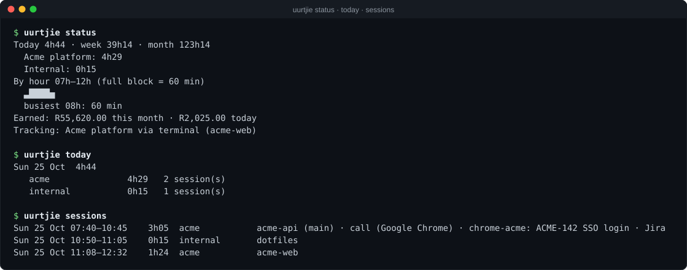
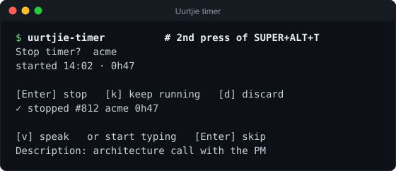
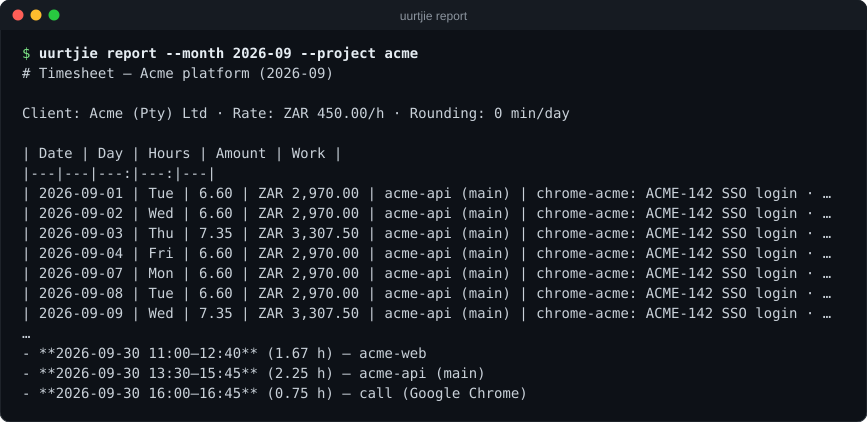
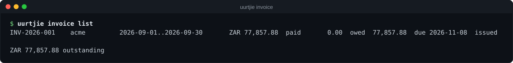

# uurtjie

[](https://github.com/jdc891010/uurtjie/actions/workflows/ci.yml)
[](https://github.com/jdc891010/uurtjie/releases/latest)
[](LICENSE)

**Client time tracking for Hyprland / Omarchy that only counts the time you are actually working on a client.**
That means time at the keyboard in the client's project folders (terminals, Herdr, Claude Code, Codex), in the
client's browser windows, and in calls. It runs in the background, shows today's hours and earnings in your bar,
and turns the month into a timesheet and an invoice.

*uurtjie* is Afrikaans for "little hour".

<p align="center"></p>

<sub>All images in this README are generated from the real code with made-up demo data (`scripts/screenshots.py`).
The bar and panel use Omarchy's theme colours; the icons are Nerd Font glyphs.</sub>

## Contents

- [What to expect](#what-to-expect)
- [How it works](#how-it-works)
- [Requirements](#requirements)
- [Install](#install)
- [Set up your projects](#set-up-your-projects)
- [Daily use](#daily-use)
- [Calls and meetings](#calls-and-meetings)
- [Reports, timesheets and invoices](#reports-timesheets-and-invoices)
- [Configuration reference](#configuration-reference)
- [Command reference](#command-reference)
- [Your data, privacy and backups](#your-data-privacy-and-backups)
- [Upgrading](#upgrading)
- [Troubleshooting](#troubleshooting)
- [Development and releasing](#development-and-releasing)
- [Roadmap](#roadmap)

## What to expect

- **Nothing to start or stop.** A user service samples your desktop every 5 seconds. Work on a client's code
  or in their browser window and the time counts. Switch to anything else, or walk away, and it stops.
- **Only what you configure counts.** You list each client's folders and browser windows. Everything else is
  ignored: other repos, personal browsing, chat apps.
- **Idle time is removed.** After 5 minutes without keyboard or mouse input, the entry is cut back to your last
  keypress, so a coffee break never ends up on an invoice.
- **Calls count without typing.** If a client's window has the microphone open, that time is recorded as a meeting.
- **A bar item** with today's hours and month-to-date earnings. Click it for the panel above, and right-click to
  start a manual timer for work away from the computer.
- **Honest numbers.** Parallel work (two terminals, a call while typing) is never double counted. Each day is
  rounded up once (default 6 minutes), the same way on the widget, the timesheet and the invoice.
- **Invoices** as HTML/PDF with a timesheet page, numbered, with VAT, payments and overdue tracking. Invoiced
  periods are locked, so the hours can't change after you've sent them.
- **Local and simple:** one SQLite file, Python standard library only, no account, no cloud.

## How it works

<p align="center"></p>

Every 5 seconds the daemon (`uurtjie daemon`, run by `uurtjie.service`) takes one sample:

1. **Are you active?** `swayidle` reports keyboard, mouse and scroll input. After `sleep_minutes` (5) with no input
   you count as away: the current entry is trimmed back to your last input and nothing accrues until you're back.
2. **What's focused?** Hyprland IPC gives the focused window's class, title and process.
3. **Which project is it?**
   - A **window rule** matches (for example the client's Chrome profile) → that project, source `chrome`.
   - A terminal running **Herdr** → Herdr's socket API returns the focused workspace and pane, its folder and
     the agent running in it (claude, codex…). The folder is matched against each project's `paths`
     (longest match wins) → source `terminal`, one entry per Herdr workspace.
   - A **plain terminal** → the folder of its foreground process (via `/proc`).
   - Anything else → not tracked.
4. **Is a call open?** A microphone stream from a project's window counts as a `meeting`, even while you're idle.

### Entries, sessions and what gets billed

<p align="center"></p>

The daemon writes fine-grained **entries**: one per Herdr workspace, browser window, call or timer. Long
stretches are cut into `chunk_minutes` (15) pieces, so a crash loses at most a few seconds.

Reports never bill raw entries. They're merged into **sessions** per project:

- Overlapping entries (parallel Herdr workspaces, a call while typing, a timer during terminal work) merge into one.
- Gaps up to `bridge_minutes` (default: `sleep_minutes`) count as work, so terminal → Chrome → terminal is one
  session. A gap is never bridged if you worked on another project in it.
- Each session lists its tasks (workspaces, branches, page titles, notes) and the git commits you made during it,
  and gets a one-line summary. Set `summary_command` to have an LLM write that summary (cached per session).

<p align="center"></p>

## Requirements

| Needed | Why | Notes |
|---|---|---|
| Linux with **Hyprland** (Wayland) | focused window | required |
| **Python 3.11+** | runs everything | standard library only, no pip packages |
| **swayidle** | keyboard/mouse activity | `install.sh` installs it on Arch/Omarchy |
| systemd user session | background service | required |
| `pactl` (PipeWire/PulseAudio) | call detection | optional: without it, calls aren't detected |
| Herdr | per-workspace terminal tracking + agent | optional: plain terminals are tracked by folder |
| Omarchy Quattro bar | bar widget + panel | optional: Waybar config in `waybar/`, or use the CLI only |
| Chrome/Chromium | invoice PDFs | optional: otherwise print the HTML to PDF |

## Install

Full step-by-step guide, written so you can also point a coding agent at it: **[INSTALL.md](INSTALL.md)**.

```bash
curl -fsSL https://github.com/jdc891010/uurtjie/releases/latest/download/uurtjie.tar.gz | tar xz
cd uurtjie && ./install.sh
```

`install.sh` copies the app to `~/.local/share/uurtjie/app`, puts the `uurtjie` commands in `~/.local/bin`,
installs `swayidle` if missing, enables `uurtjie.service`, installs the bar widget when Omarchy Quattro is present,
and writes `~/.config/uurtjie/config.toml` from `config.example.toml` if you have none. Re-running it upgrades in place
and never touches your config or data. Releases: <https://github.com/jdc891010/uurtjie/releases> (the last 3 versions).

## Set up your projects

Edit `~/.config/uurtjie/config.toml` (or use `uurtjie config edit`, which rolls back invalid edits), then run
`uurtjie reload`. A guided `uurtjie setup` wizard is on the [roadmap](#roadmap). A minimal project:

```toml
default_project = "acme"          # used by the timer and quick-add when nothing else says which project

[[projects]]
id = "acme"
name = "Acme platform"
client = "Acme (Pty) Ltd"
rate = 950                        # per hour; needed for earnings and invoices
currency = "ZAR"
paths = ["~/code/acme", "~/work/acme-infra"]   # terminal/Herdr/Claude Code/Codex work under these folders counts

[[projects.windows]]              # browser windows that count (see below)
class = "chrome-acme"
```

Check what you configured with `uurtjie projects`, and what is being tracked right now with `uurtjie status`.

### Terminals, Herdr and coding agents

Any terminal in `terminal_classes` (foot, Alacritty, ghostty, kitty, WezTerm by default) whose working folder is
under a project path counts. With Herdr, uurtjie asks Herdr's socket (`~/.config/herdr/herdr.sock`; set
`herdr_socket` for a named session) which workspace and pane is focused, so each workspace becomes its own entry,
with the agent recorded. Check what it sees with `herdr pane list`. To bill terminal time **only while Claude Code
or Codex runs** in the focused pane, set `require_agent = true` on the project (`agents` lists which agents count).

### The client's browser profile

Chrome profiles that share one Chrome process all report the same window class, so Hyprland can't tell them apart.
Two options:

- **Distinct class (reliable):** run the client's profile from its own data directory with its own class. Copy
  `chrome/chrome-client.desktop` to `~/.local/share/applications/`, edit the names, and match it with
  `class = "chrome-acme"`. This is a fresh profile, so you sign in once.
- **Title match (no migration):** keep your existing profile and match a title regex, for example
  `class = "google-chrome"` and `title = "acme\\.atlassian\\.net|Acme"`. The title is re-checked every sample, so
  switching to a personal tab stops tracking immediately.

Find a window's class and title with `hyprctl activewindow`. Rules work for any app (Figma, Slack, a client's
Electron app), not only browsers.

## Daily use

### The bar widget

The bar shows today's hours, the project being tracked, and money earned so far this month, for example
`󰥔 4h24 acme · R117,135`. It is dimmed while you're idle.

| Click | Does |
|---|---|
| Left | opens the panel (pictured at the top): today, week, month, earnings, time per project, today by hour, what's tracked now, invoices owed, buttons for the timer, the week in a terminal, a CSV export and the live log |
| Right | starts the manual timer, or opens the stop popup if one is running |
| Middle | live log (`journalctl --user -u uurtjie -f`) |

Earnings are calculated exactly like an invoice (per day: session hours × `human_factor`, rounded up to
`rounding_minutes`, × `rate`), so they match what you will bill. Hide the amount from the bar with
`uurtjie config set show_money_in_bar false`. The panel and tooltip keep it. Without Quattro, use
`waybar/uurtjie.jsonc` (`uurtjie status --waybar`).

### Keyboard shortcuts and the timer

`install.sh` installs `~/.config/hypr/uurtjie.lua` (Lua config) or `uurtjie-bindings.conf` (classic config) and prints
the line to add to your bindings. Check for clashes with your own SUPER+ALT bindings first.

| Keys | Action |
|---|---|
| SUPER+ALT+T | Timer: 1st press starts it, 2nd press opens the stop popup |
| SUPER+ALT+U | Today / week / month as a notification |
| SUPER+ALT+Z | Undo the last manual entry |
| SUPER+ALT+A | Quick-add popup (commented out by default) |

<p align="center"></p>

The **manual timer** is for work away from the keyboard, such as whiteboarding or a phone call. It runs regardless of
idle. The first press starts it for the project you're focused on (else `default_project`). The second press stops it
at the moment you pressed: **Enter** stops, **k** keeps it running, **d** discards. A timer under a minute is
discarded without asking. You can then type a description, or press **v** and speak it if Omarchy's dictation
(Voxtype) is installed (Omarchy menu › Install › AI › Dictation).

### Adding and fixing time

```bash
uurtjie add acme --from 09:00 --to 10:15 --note "standup + planning"
uurtjie add acme -d 45m --date 2026-10-20 --note "call with PM" --non-billable
uurtjie q acme 1h30 call with PM          # quick add: 1.5 h ending now
uurtjie q y 2h code review                # yesterday, ending 17:00, default project
uurtjie q 09:00-10:30 standup             # a range today
uurtjie q fri 45m docs nb                 # last Friday, non-billable
uurtjie log --date yesterday              # raw entries with ids
uurtjie edit 42 --to 17:30 --note "deploy"
uurtjie edit 43 --billable no
uurtjie rm 44
uurtjie undo                              # remove the last manual entry
```

Quick-add tokens can be in any order. A unique prefix of a project id is enough (`acme-i` for `acme-infra`).

## Calls and meetings

Tracking stops after `sleep_minutes` without input, which would drop a 40-minute call. So uurtjie also watches the
**microphone**. When a project's window, or the process behind it, has a microphone stream open for
`meeting_min_seconds` (30), that time is recorded as a `meeting` entry for the project, even while you're idle.

- It is matched through the window rules. A dedicated client browser counts as soon as you join a call in it,
  whichever window is focused. A browser shared with personal windows only counts while the project's window is focused.
- A microphone that goes quiet for less than `meeting_grace_seconds` (120, for example while muting) is the same call.
- Screen recorders and screen sharing (which capture your speakers) and dictation (`voxtype`) don't count. Add other
  apps to `meeting_ignore`. Turn the feature off with `meeting_detect = false`.
- Calls overlap your normal entries, and sessions never double count, so a call while typing is billed once.

## Reports, timesheets and invoices

```bash
uurtjie report --month 2026-10 --project acme                 # markdown timesheet
uurtjie report --month 2026-10 --project acme -f csv -o ~/invoices/{project}-{period}.csv --record
uurtjie report --month 2026-10 --project acme -f json         # stable JSON for your own tooling
uurtjie report --by session                                   # one row per session (or day-only)
uurtjie sessions --date yesterday --json                      # sessions with tasks, commits and summaries
uurtjie export                                                # every entry as CSV in your Documents folder
```

<p align="center"></p>

### Invoices

```bash
uurtjie config invoice                             # once: your details, bank and the client's address (guided)
uurtjie invoice create --month 2026-10 --dry-run   # figures only: nothing saved, nothing locked
uurtjie invoice create --month 2026-10 --pdf       # issue INV-2026-001, write HTML (+ PDF)
uurtjie invoice list                               # numbers, paid / owed, due dates, state
uurtjie invoice show 001
uurtjie invoice sent 001                           # mark as sent
uurtjie invoice paid 001 [--amount 5000] [--date 2026-11-12]   # default: the full outstanding amount
uurtjie invoice void 001 --yes                     # cancel and unlock; the number is never reused
uurtjie invoice unbilled                           # months with tracked time that no invoice covers
uurtjie invoice render 001 --pdf --detail sessions # rewrite the files from the frozen figures
```

<p align="center"></p>

<p align="center"></p>

- **Default period:** without `--month`, `create` bills last calendar month. `--from/--to` bills any range of whole days.
- **Locking.** Issuing an invoice locks its period for that project: `add`, `quick`, `edit`, `rm` and `undo` refuse to
  touch time inside it (`--force` overrides, or void the invoice first). A period that includes today, or that overlaps
  another invoice, is refused.
- **Frozen figures.** Hours, rate, VAT and the daily breakdown are stored with the invoice, so later config changes
  never alter one you've sent. A database backup is taken before each issue.
- **Money.** Per day: session hours × `human_factor`, rounded up to `rounding_minutes`. Subtotal = hours × rate, plus
  VAT = subtotal × `vat_rate` %. Part payments are fine. The state goes `issued` → `sent` → `part-paid` / `overdue` →
  `paid`, and outstanding amounts show in the panel and tooltip.
- **What the client sees.** Page 1 is the invoice, page 2 the timesheet (decimal hours per day). Window titles and work
  summaries are only included with `--detail sessions`, so nothing from your screen leaks by default.
- **Files** go to `[invoice] dir` (default `~/.local/share/uurtjie/invoices`). `--pdf` prints with headless
  Chrome/Chromium; without one, open the HTML and print to PDF.

## Configuration reference

`~/.config/uurtjie/config.toml`. `config.example.toml` is a commented starting point. Change values without
hand-editing with `uurtjie config set <key> <value> [--project id]` (comments and layout are kept, typos are rejected,
the previous file is kept as `config.toml.bak`), and inspect with `uurtjie config show`. The daemon reloads by itself
after `config set`; after a manual edit run `uurtjie reload`.

| Top level | Default | Meaning |
|---|---|---|
| `default_project` | none | project for the timer and quick-add when nothing else decides |
| `sleep_minutes` | 5 | no input this long = away; the entry is cut back to your last input |
| `bridge_minutes` | = `sleep_minutes` | gaps up to this inside one project join one session |
| `rounding_minutes` | 6 | each day is rounded **up** to this (0 = exact) |
| `chunk_minutes` | 15 | long entries are written in pieces of this size |
| `tick` | 5 | seconds between samples |
| `terminal_classes` | foot, Alacritty, ghostty, kitty, WezTerm | window classes treated as terminals |
| `herdr_socket` | `~/.config/herdr/herdr.sock` | Herdr session to ask |
| `git_author` | your `git config user.email` | whose commits are attached to sessions |
| `summary_command` | none | command that gets a session as JSON on stdin and prints a one-line summary, e.g. `claude -p '…'` |
| `show_money_in_bar` | true | month-to-date earnings in the bar |
| `meeting_detect` | true | count open-microphone time as calls |
| `meeting_min_seconds` / `meeting_grace_seconds` | 30 / 120 | shortest call; silence that still counts as the same call |
| `meeting_ignore` | voxtype, pavucontrol, speech-dispatcher | apps whose microphone use is never a call |
| `backup_dir` / `backup_keep` | `~/.local/share/uurtjie/backups` / 30 | daily database backups |

| Per `[[projects]]` | Default | Meaning |
|---|---|---|
| `id`, `name`, `client` | | identifier (used on the CLI), display name, client name on invoices |
| `rate`, `currency` | 0, ZAR | hourly rate; earnings and invoices need a rate |
| `human_factor` | 1.0 | multiply tracked hours before rounding (e.g. 0.8) |
| `paths` | [] | folders whose terminal work counts (longest match wins) |
| `[[projects.windows]]` | | `class` (exact) and/or `title` (regex) of windows that count |
| `require_agent`, `agents` | false, [claude, codex] | only count terminal time while one of these agents runs |
| `client_address`, `client_vat_number`, `client_reference` | | shown on invoices |

| `[invoice]` / `[invoice.from]` | Default | Meaning |
|---|---|---|
| `number_format` | `INV-{year}-{seq:03d}` | also `{project}` |
| `payment_terms_days` | 14 | due date |
| `vat_rate` | 0 | percent; 0 = no VAT line |
| `dir` | `~/.local/share/uurtjie/invoices` | where HTML/PDF files go |
| `from.name`, `address`, `email`, `phone`, `vat_number`, `reg_number`, `bank`, `footer` | | your details on the invoice |

Environment: `UURTJIE_CONFIG` and `UURTJIE_DATA` move the config file and data directory, and `UURTJIE_LOG=DEBUG` (in the
unit) logs every sample.

## Command reference

| Command | Does |
|---|---|
| `uurtjie status [--json\|--waybar]` | today / week / month, earnings, what is tracked now (also feeds the widget) |
| `uurtjie today`, `uurtjie week` | totals per day and project |
| `uurtjie sessions [--date D] [--days N] [--project P] [--json]` | sessions with tasks, commits and summaries |
| `uurtjie log [--date D] [--days N] [--project P] [--json]` | raw entries with ids |
| `uurtjie add`, `uurtjie quick` / `q`, `uurtjie edit`, `uurtjie rm`, `uurtjie undo` | manual entries and corrections |
| `uurtjie start [P] [-n note]`, `uurtjie stop [--discard]`, `uurtjie toggle`, `uurtjie timer` | manual timer |
| `uurtjie report [--month M] [--project P] [-f md\|csv\|json] [--by day\|session\|day-only] [-o file] [--record]` | timesheets |
| `uurtjie invoice create\|list\|show\|sent\|paid\|void\|unbilled\|render` | invoices and payments |
| `uurtjie export [--project P] [--to DIR]` | every entry as CSV |
| `uurtjie projects` | configured projects with their rates, folders and window rules |
| `uurtjie config show\|set\|invoice\|edit` | settings without hand-editing |
| `uurtjie reload` | make the running daemon re-read the config |
| `uurtjie backup [--now] [--list] [--to DIR]` | database backups |
| `uurtjie where` | where the config, database, live state and backups are |
| `uurtjie daemon` | the tracker itself (run by `uurtjie.service`) |

Every command has `--help`. `--date` accepts `YYYY-MM-DD`, `today` and `yesterday`.

## Your data, privacy and backups

- **Everything stays on your machine.** The only exception is the optional `summary_command`: it receives each session
  as JSON (tasks, page titles, commits) and sends it wherever that command sends it, for example Claude Code.
- **What is stored** in `~/.local/share/uurtjie/uurtjie.db` (SQLite): for each entry the project, start and end, source,
  and details such as the Herdr workspace, folder, git branch, agent and window title. Timers, invoices (with a frozen
  copy of their figures) and payments are stored too. Untracked windows are never written to the database.
- **Live state** (what is being tracked right now) is in `$XDG_RUNTIME_DIR/uurtjie/state.json`.
- **Backups:** the daemon writes a verified copy of the database once a day and keeps `backup_keep` (30). Point
  `backup_dir` at a synced folder for off-machine copies. `uurtjie backup --now` makes an extra copy, for example
  before month-end. To restore: `systemctl --user stop uurtjie`, copy a backup over the database, then
  `systemctl --user start uurtjie`.
- **Query it yourself:**

  ```bash
  sqlite3 ~/.local/share/uurtjie/uurtjie.db \
    "SELECT date(start_local) d, project, round(sum(hours),2) FROM spans_local WHERE billable GROUP BY d, project"
  ```

  Tables: `spans` (entries), `timer`, `invoices`, `payments`, `summaries`, view `spans_local`. Summing `spans` directly
  can double count overlaps; `uurtjie report` doesn't. For integrations, `uurtjie report -f json` and
  `uurtjie sessions --json` are the stable interfaces.

## Upgrading

Download a newer release and run its `./install.sh` (see [INSTALL.md](INSTALL.md#upgrade)). Your config, database and
backups are kept. The panel tells you when the bar widget is older than the app.

**From tally (≤ 0.2.x):** uurtjie is tally's new name. `install.sh` migrates in place: database, backups and config move
to `~/.local/share/uurtjie` and `~/.config/uurtjie`, the old `tally` service, commands and bar widget are removed, and
the `source =` line in `~/.config/hypr/bindings.conf` is rewritten (the original is kept as `bindings.conf.tally-bak`).
If both tally and uurtjie data exist, it stops and asks you to merge by hand. Use `UURTJIE_*` where you used `TALLY_*`.

## Troubleshooting

| Symptom | Check |
|---|---|
| Nothing is tracked | `systemctl --user status uurtjie`; `journalctl --user -u uurtjie -f` while you work |
| A terminal isn't tracked | its class is in `terminal_classes` (`hyprctl activewindow`) and its folder (or the Herdr pane's) is under a project path |
| A browser window isn't tracked | `hyprctl activewindow` class/title against your `[[projects.windows]]` rules |
| Time stops while reading | expected after `sleep_minutes` without input; raise it, or use the timer |
| A call wasn't counted | `pactl` installed, the call's window matches a project rule, the app isn't in `meeting_ignore` |
| Widget shows `uurtjie?` | `~/.local/bin/uurtjie status --json` must run cleanly |
| No earnings shown | the project needs a `rate` |
| More detail | set `Environment=UURTJIE_LOG=DEBUG` in the unit (`systemctl --user edit uurtjie`) |

## Development and releasing

```bash
python3 -m unittest discover -s tests            # the app (stdlib unittest, no dependencies)
python3 -m unittest discover -s scripts/tests    # release tooling: unit + security tests
python3 scripts/screenshots.py                   # regenerate the README images from demo data
```

Merging into the `release` branch publishes a GitHub Release (`.github/workflows/release.yml`). Tests run,
`scripts/build-release.sh` builds `uurtjie-<version>.tar.gz` (plus `uurtjie.tar.gz` for the stable "latest" link, and
`SHA256SUMS`), and the matching `CHANGELOG.md` section becomes the release notes. Only the newest 3 releases stay hosted;
older ones are deleted, but their git tags are kept.

With Claude Code, ask it to *prepare a release*: the project skill `.claude/skills/release-notes` reads the commits since
the last tag, proposes the version, writes the changelog section and validates it. By hand, the same steps with
`scripts/changelog.py`:

1. `python3 scripts/changelog.py commits`: what changed since the last release (JSON).
2. `python3 scripts/changelog.py bump patch|minor|major`: updates `uurtjie/__init__.py` **and** the widget manifest.
3. `python3 scripts/changelog.py add X.Y.Z --notes-file notes.md`: inserts the dated section (refuses malformed notes,
   secrets and absolute home paths).
4. `scripts/build-release.sh --check` (CI runs the same check on every PR).
5. Open a PR from `main` into `release` and merge it. Re-merging without a version bump fails instead of overwriting.

The release tooling is also mutation tested (`mutmut run`; config and the known-equivalent mutants are in `setup.cfg`),
and CI fails on new surviving mutants.

## Roadmap

- `uurtjie setup`: a guided first-run wizard that explains how tracking works, suggests folders from recent Claude Code /
  Herdr / git activity, lets you pick browser windows from the ones open right now, and asks for rates and currency.
- A configurable `timezone` / UTC offset for day boundaries (today: the system's timezone).
- An installer that works beyond Arch/Omarchy's `pacman`.
- Crediting remote/SSH coding sessions through a Claude Code hook.
- Agent working time (Herdr `agent_status = working`) as a separate, non-billable series.

## License

[MIT](LICENSE)
