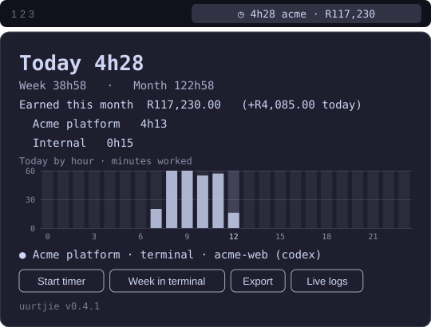
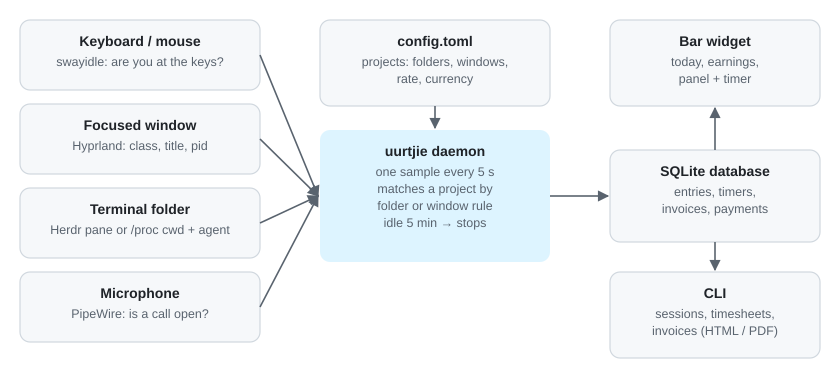
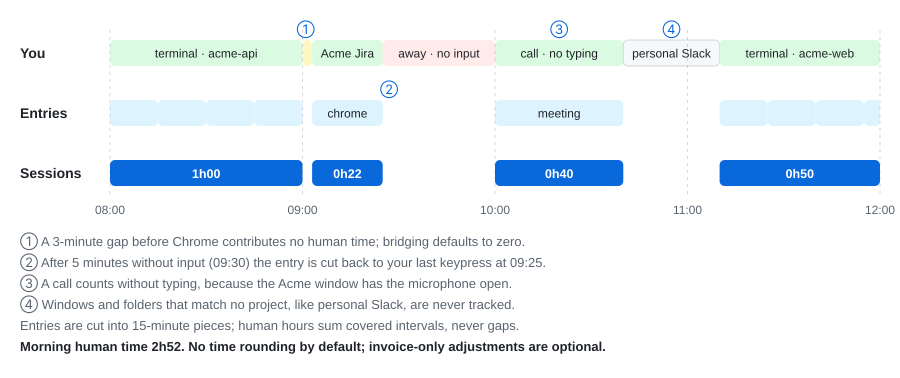
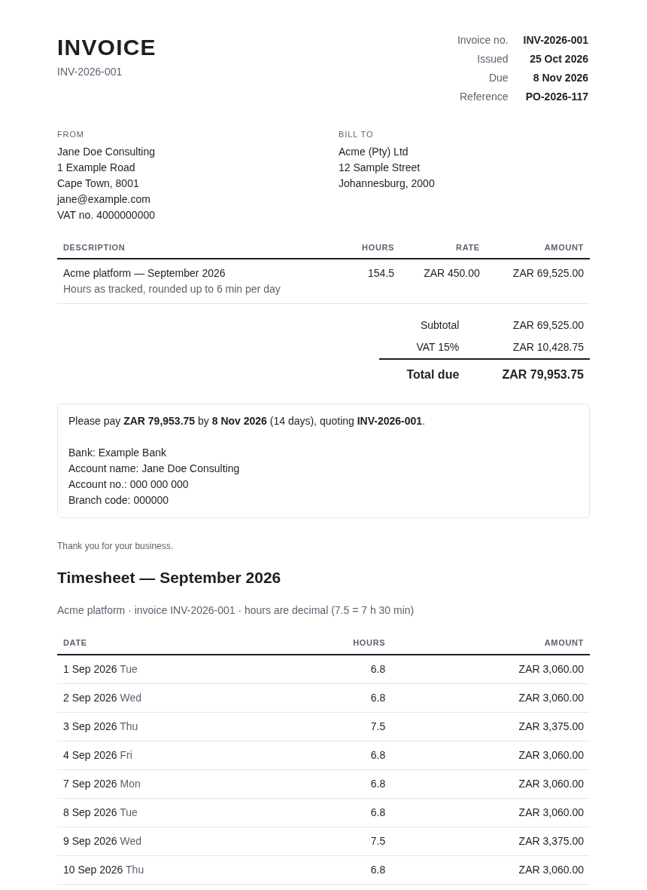

<!--
  Substack article about uurtjie.
  Images point at ../images/ so they render on GitHub. For Substack, upload the files from docs/images in the same
  places. All images use made-up demo data (scripts/screenshots.py).
-->

<h1 align="center">The little hour</h1>

<p align="center"><em>Stop tracking your time. Let it track itself, and spend your attention on the work.</em></p>

<p align="center"></p>

---

It's the last working day of the month. The invoice is due, and you're sitting with your calendar in one tab, your git
log in another, and a half-remembered week in your head. *Was Tuesday afternoon the client's bug or my own side
project? Did that call run for 40 minutes or an hour and a half?* You round a few numbers, feel slightly guilty about
it, and send the invoice anyway.

If that sounds familiar, you're not bad at admin. You were busy doing the actual work, and that's exactly the point.

> **Time tracking is admin that competes with the work it's supposed to measure.**

I built **uurtjie** (Afrikaans for *"little hour"*) to get that admin out of the way. This is what it does, why it
helps, and where it stops.

## The tax nobody invoices

Most time trackers ask you to do two jobs at once. You do the work, and you also keep a running commentary about the
work: start the timer, switch the project, stop the timer, remember you forgot to stop the timer, fix the entry.

Each of those is tiny. Together they leave a small background process running in your head all day:

- *Is the timer on?*
- *Which client is this for?*
- *I should write that down before I forget.*

That background process is not free. It's the same attention you need to hold a tricky design in your head, follow a
bug through four files, or have the idea you only get after an hour of uninterrupted thinking. Creative work needs
long stretches of focus, and constant self-bookkeeping chips away at them.

And when you skip the bookkeeping to protect your focus, you pay at the end of the month instead, with guesswork.

## What if the computer just noticed?

Here's the thing: your computer already knows what you're working on.

It knows which window is in front. It knows which folder your terminal is in. It knows when you've stopped touching
the keyboard. It knows when your microphone is open for a call.

uurtjie simply pays attention to that, every five seconds, quietly in the background:

<p align="center"></p>

You tell it once which folders and which browser windows belong to which client. After that:

- **Working in a client's code?** That counts, whether you're typing yourself or working alongside a coding agent like
  Claude Code in that client's folder.
- **In the client's browser window,** on their Jira or their dashboard? That counts.
- **On a call** in that window, even while you're just listening? That counts as a meeting.
- **Anything else,** your own projects, personal browsing, the group chat? Ignored. It never even gets written down.
- **Walked away to make coffee?** After five minutes without input, the time is cut back to your last keypress. Your
  coffee break never ends up on an invoice.

There's nothing to start and nothing to stop. You open the laptop and work.

> **The best time tracker is the one you forget is running.**

## What a day actually looks like

Real days are messy. You jump from the terminal to the client's ticket board and back. You step away. You take a call.
You check Slack. uurtjie turns that mess into clean, defensible blocks of work:

<p align="center"></p>

Jumping straight from your code to the client's ticket loses no time, and adds none either. A few minutes spent
somewhere else stay out. A call while you're also typing is counted once. Thirty-five minutes away from the desk is
simply not there. Each session lists what you worked on: the branch, the page titles, the commits you made during it.

## Glance, don't manage

The only thing you see during the day is a small item in your status bar:

<p align="center"><code>󰥔 4h24 acme · R55,620</code></p>

Today's hours, the project being tracked right now, and what you've earned this month. It dims when you're idle. You
glance at it the way you glance at the clock, and then you go back to work.

That number changes how a day feels. You stop wondering whether you've "done enough". You can see it, and it's
honest, so you can let it go.

For the work a computer can't see, like sketching on a whiteboard or thinking on a walk, there's a manual timer:
one keypress to start, one to stop.

## Numbers you can stand behind

Billing by the hour is a matter of trust. uurtjie is built to keep that trust easy:

| | Guessing at month-end | uurtjie |
|---|---|---|
| **Where hours come from** | Memory, calendar, git log | What you actually worked on |
| **Breaks and idle time** | Easy to forget to subtract | Removed automatically |
| **Calls while you type** | Easy to count twice | Counted once |
| **Rounding** | Whatever felt fair that day | None by default; optional on invoices only |
| **After the invoice is sent** | Hours can quietly drift | The period is locked |

The bar counts your time the strict way: every second goes to one client, never two. If a timer is running, it wins.
Otherwise a call wins over whatever window is in front. Time nobody can account for doesn't count at all.

Your earnings are simply that time multiplied by your rate, so out of the box the number in your bar is the number
on your invoice. If you'd rather round invoices up, you can, and the panel tells you why the two differ.

## Month-end in one command

Here's where the admin really disappears. When the month is over:

```bash
uurtjie invoice create --pdf
```

That's the whole ritual. You get a numbered invoice with VAT, payment details, and a timesheet page behind it:

<p align="center"></p>

uurtjie also keeps track of what's been sent, what's been paid, and what's overdue. The client sees hours per day by
default. Your window titles and work notes stay private unless you choose to include them.

The evening of reconstructing your month becomes a quick check.

## Room to think

Here's the part I care about most.

When you trust that the record is being kept, something small but real happens: you stop keeping it in your head.
You don't break a good stretch of focus to log a switch. You don't carry a low hum of *"don't forget to write this
down"*. You stop judging your own day by a timer you have to babysit.

That freed-up attention goes where it should: to the problem in front of you. To trying the odd idea. To following a
thought further than you would have if part of your brain was watching the clock.

> **uurtjie doesn't make you more creative. It just stops taking a little bit of your focus every few minutes.**

Admin doesn't vanish completely. You still set up your clients once and glance over the numbers before you send them.
But it shrinks from a daily background task to a monthly check, and that's a trade most people who bill by the hour
would happily take.

## What it won't do

To be upfront about the limits:

- **It runs on Linux with Hyprland,** built with Omarchy in mind. It doesn't run on macOS or Windows.
- **Setup is a config file today.** You list your clients' folders and windows yourself. A guided setup wizard is on
  the roadmap.
- **It can't see thinking that happens away from the keyboard.** That's what the manual timer is for.
- **It isn't surveillance.** It's your data, about you, for you. Everything stays in one small database on your own
  machine, there's no account and no cloud, and windows it doesn't track are never stored.

## Try it

uurtjie is free and open source (MIT):

**[github.com/jdc891010/uurtjie](https://github.com/jdc891010/uurtjie)**

```bash
curl -fsSL https://github.com/jdc891010/uurtjie/releases/latest/download/uurtjie.tar.gz | tar xz
cd uurtjie && ./install.sh
```

The [install guide](../../INSTALL.md) walks you through it step by step. It's even written so you can hand it to a
coding agent and let it do the installing.

If you bill by the hour and you'd rather spend your attention on the work than on the paperwork about the work, give
it a month. Then see how your next month-end feels.

---

<p align="center"><sub><em>uurtjie</em>, Afrikaans for "little hour". Because the hours add up, and you shouldn't
have to.</sub></p>
